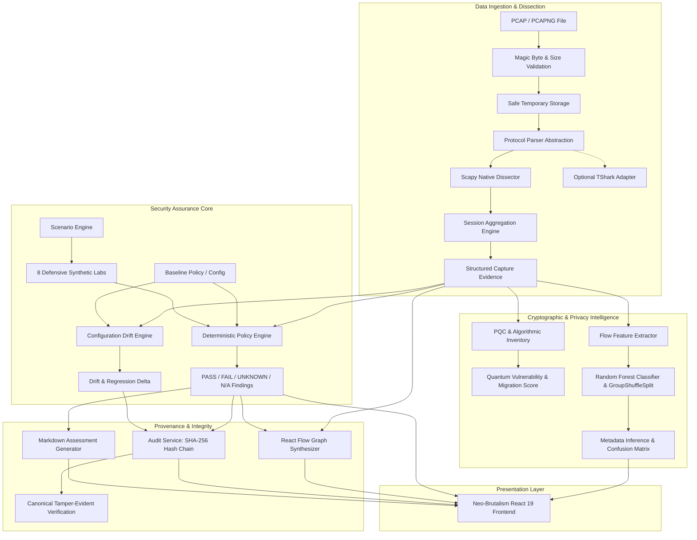

# IKETrace System Architecture

## 1. Architectural Overview

IKETrace is an offline-first defensive cybersecurity workbench for VPN security assurance, cryptographic policy enforcement, configuration drift detection, and metadata-based privacy exposure analysis. It enforces a strict separation between **direct empirical observations**, **deterministic policy evaluations**, **tamper-evident audit trails**, and **statistical machine learning inferences**.

---

## 2. Component Design & Responsibilities

### 2.1 Ingestion & Dissection Layer (`backend/app/services/protocol_parser.py`, `capture_service.py`)
- **Magic-Byte Pre-filter**: Inspects file headers for standard libpcap (`\xa1\xb2\xc3\xd4`, `\xd4\xc3\xb2\xa1`) and pcapng (`\x0a\x0d\x0d\x0a`) signatures before invoking any parser.
- **Protocol Dissector Abstraction (`ProtocolParser`)**:
  - `ScapyProtocolParser`: Fully offline pure-Python dissector extracting ISAKMP, IKEv1, IKEv2 (RFC 7296), SA Proposals, Transforms (Encryption, PRF, Integrity, DH Groups), Key Exchanges (KE payloads), and ESP traffic.
  - `TSharkProtocolAdapter`: Dissects via external TShark CLI when installed, gracefully degrading to `ScapyProtocolParser` if TShark is absent.
- **Evidence Provenance Tagging**: Every parsed attribute carries an `ObservationMethod`:
  - `DIRECT_OBSERVATION`: Unencrypted cleartext fields directly seen in packet payloads (e.g., IKE_SA_INIT proposals).
  - `DETERMINISTIC_DERIVATION`: Structurally deduced values (e.g., handshake completion state).
  - `SUPPLIED_CONFIGURATION`: Declared admin settings.
  - `CONTROLLED_LAB_EXPERIMENT`: Synthetic scenario results.
  - `UNKNOWN_UNSUPPORTED`: Obfuscated, encrypted, or unsupported protocol segments.

### 2.2 Deterministic Policy Engine (`backend/app/services/policy_engine.py`)
- **Pure-Function Security Verdicts**: Rules evaluate parsed evidence without heuristics or probabilistic AI.
- **Four Canonical Outcomes**:
  - `PASS`: Direct empirical evidence confirms compliance with rule specifications.
  - `FAIL`: Direct evidence confirms a violation (e.g., deprecated 3DES, MD5, DH Group 2, or cleartext IKEv1).
  - `UNKNOWN`: Incomplete handshake, truncated capture, or encrypted negotiation prevents verification. *Crucially, UNKNOWN is never treated as PASS.*
  - `NOT_APPLICABLE`: Requirement does not apply to the observed protocol family (e.g., IKEv2-specific rules evaluated on pure IKEv1).
- **Embedded Baselines**:
  - `CNSA 2.0 (POL-DEF-CNSA-2.0)`: Commercial National Security Algorithm Suite mandates AES-256-GCM, SHA-384 PRF, and Post-Quantum hybrid/DH group 21 (ECP-521).
  - `NIST SP 800-77 Rev 1 (POL-DEF-NIST-SP800-77)`: Guide to IPsec VPNs mandating minimum AES-128, SHA-256, and DH group >= 14.

### 2.3 Synthetic Scenario Engine (`backend/app/services/scenario_engine.py`)
Provides 8 reproducible defensive lab scenarios demonstrating failure modes and edge cases:
- `SCEN-01-SECURE-BASELINE`: Clean IKEv2 AES-256-GCM negotiation with SHA-384 and DH Group 19.
- `SCEN-02-PROHIBITED-CRYPTO`: 3DES-CBC and HMAC-MD5 violation detection.
- `SCEN-03-INCOMPLETE-EVIDENCE`: Truncated single-packet capture producing UNKNOWN verdicts.
- `SCEN-04-DECLARED-MISMATCH`: Mismatch between declared CNSA 2.0 policy and observed AES-128 negotiation.
- `SCEN-05-CONFIG-DRIFT`: Regression from secure baseline to deprecated algorithms.
- `SCEN-06-REGRESSION-RESOLVED`: Correction of drift and subsequent clean verification pass.
- `SCEN-07-MALFORMED-CAPTURE`: Corrupted PCAP payload handled safely without crashes.
- `SCEN-08-INCONSISTENT-CONFIG`: Gateway configuration referencing contradictory crypto proposals.

### 2.4 Cryptographic Inventory & PQC Readiness (`backend/app/services/crypto_inventory.py`)
- Catalogs all cryptographic assets observed in traffic or declared in configs.
- Maps quantum vulnerability using standard threat models:
  - **Shor's Algorithm**: Complete compromise of RSA, DSA, ECDSA, DH, and ECDH.
  - **Grover's Algorithm**: Effective key length halved for symmetric ciphers (AES-128 reduced to 64-bit security; AES-256 remains at 128-bit quantum security).
- Computes **Post-Quantum Readiness Score (0-100%)** assessing migration readiness toward CNSA 2.0.

### 2.5 Metadata Privacy Exposure Lab (`backend/app/services/traffic_privacy.py`, `backend/app/ml/`)
- Demonstrates what information adversaries can infer from encrypted traffic **without decrypting ESP payloads**.
- Extracts statistical metadata features: packet length distributions, inter-arrival times, burst ratios, and flow durations.
- Trains a `RandomForestClassifier` with `GroupShuffleSplit` grouping by `session_id` to strictly prevent data leakage between sessions.
- Generates transparent confusion matrices, per-class F1-scores, and Gini feature importances.

### 2.6 Tamper-Evident Audit Service (`backend/app/services/audit_service.py`)
- Records all security evaluations in a canonical JSON format (`RFC 8785` principles).
- Implements a sequential SHA-256 hash chain:
  $$H_i = \text{SHA-256}(H_{i-1} \parallel \text{CanonicalJSON}(E_i))$$
- Detects arbitrary record tampering, attribute alteration, or historical revision.

---

## 3. Technology Stack & Directory Structure

| Layer | Technologies |
|---|---|
| **Frontend** | React 19, TypeScript (strict), Vite, Tailwind CSS + Custom Neo-Brutalist Design Tokens, Lucide Icons, Recharts, @xyflow/react |
| **Backend** | Python 3.14 / 3.11+, FastAPI, Pydantic v2, Scapy, NumPy, Pandas, scikit-learn, cryptography |
| **Testing** | pytest (Python), oxlint & TypeScript compiler checks (Frontend) |
| **Persistence** | SQLite / Safe Temporary File Stores with canonical JSON serialization |
