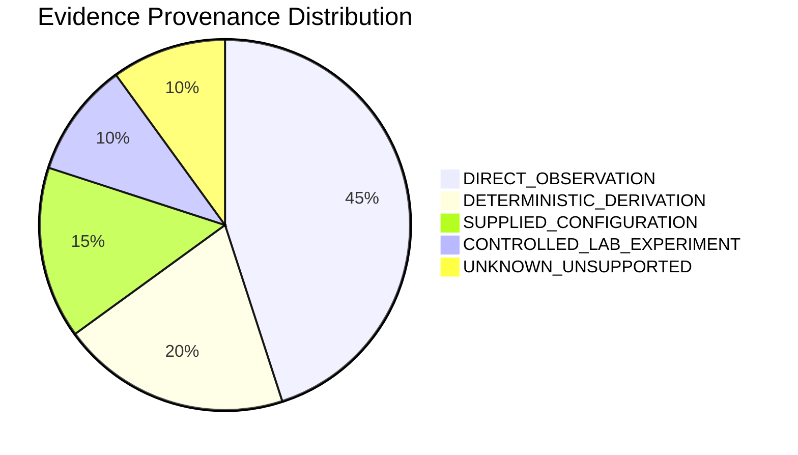

# IKETrace Security Model & Defensive Posture

## 1. Defensive Scope & Guarantees

IKETrace is strictly a **defensive security assurance workbench**. It does not perform offensive penetration testing, generate denial-of-service traffic, attack VPN endpoints, or attempt cryptanalysis to recover session keys or decrypt encrypted traffic.

> [!IMPORTANT]
> **Fundamental Security Axiom**: The absence of a detected policy violation is **not** proof that a VPN connection is secure. IKETrace can only prove compliance for properties that are directly or deterministically observable within the analyzed evidence.

---

## 2. Threat Model & Untrusted Inputs

IKETrace operates under the principle that **all external inputs are untrusted**:

| Input Channel | Threat Category | Defensive Safeguard in IKETrace |
|---|---|---|
| **PCAP / PCAPNG Files** | Parser exploits, zip bombs, infinite loops, malformed headers | Strict 25MB file upload limit, magic-byte header pre-validation, bounded packet read loops (`MAX_PACKETS=5000`), safe exception handling in Scapy and TShark adapters. |
| **Supplied Configurations** | Command injection, path traversal, malicious formatting | Treated as static key-value data structures. Parsed with Pydantic v2 schemas; never executed, evaluated via `eval()`, or passed to shell commands. |
| **Subprocess Execution** | Arbitrary code execution, shell injection | Subprocess calls (e.g. optional TShark) **never use `shell=True`**, pass argument lists with absolute executable paths, and enforce strict execution timeouts (15s). |
| **Audit Logs** | Historical revision, log tampering, retroactive record alteration | Sequential SHA-256 hash chaining with canonical JSON normalization (`RFC 8785`), flagging any mismatch between stored hash and recomputed digest. |
| **AI / LLM Integrations** | Hallucinated observations, prompt injection, policy bypass | AI outputs are strictly advisory. **AI never makes policy determinations (PASS/FAIL/UNKNOWN)** and cannot invent packet fields or override deterministic policy engines. |

---

## 3. Evidence Provenance & Taxonomy of Truth

To prevent misleading claims, IKETrace categorizes every extracted data point into one of five mutually exclusive provenance categories:



1. **`DIRECT_OBSERVATION`**:
   - Cleartext fields observed directly on the wire (e.g., IKEv2 `IKE_SA_INIT` Proposal payload containing `ENCR=AES_GCM_16`, `KEY_LEN=256`, `PRF=HMAC_SHA384`, `DH=GROUP_19`).
   - High confidence empirical evidence.
2. **`DETERMINISTIC_DERIVATION`**:
   - Mathematically or structurally deduced conclusions (e.g., handshake completion deduced from observing matching SPIs across Request and Response pairs).
3. **`SUPPLIED_CONFIGURATION`**:
   - Declared properties extracted from an administrator's IPsec configuration file (e.g., `strongSwan` `ipsec.conf` or Cisco ASA config snippet).
   - *Limitation*: Proves intent, but does not prove what was negotiated on the wire.
4. **`CONTROLLED_LAB_EXPERIMENT`**:
   - Synthetic packet sequences generated in isolated test suites or simulated regression scenarios.
   - Distinctly tagged with `is_synthetic=True` to prevent confusion with production captures.
5. **`UNKNOWN_UNSUPPORTED`**:
   - Protocol segments that are encrypted (e.g., `IKE_AUTH` encrypted payloads, ESP SPI contents), truncated, or use proprietary vendor-specific extensions.

---

## 4. Cryptographic Realism: No Payload Decryption

A core engineering principle of IKETrace is scientific and cryptographic honesty:
- **No Private Key Recovery**: IKETrace does not attempt to break Diffie-Hellman exchanges or infer private key material.
- **No ESP Ciphertext Decryption**: Without access to derived session keys (`SK_ei`, `SK_er`) and explicit session dumps, encrypted ESP packets are analyzed **exclusively via visible outer metadata**:
  - Security Parameter Index (SPI)
  - Sequence numbers
  - Outer IP addresses and transport protocol (ESP / IP proto 50)
  - Packet lengths and inter-arrival timing
- **No Algorithm Guessing from Ciphertext**: IKETrace strictly refrains from guessing encryption algorithms based on packet lengths or entropy of ciphertext. If negotiation was not observed in cleartext, the algorithm is marked as `UNKNOWN`.

---

## 5. Tamper-Evident Audit Mechanism

IKETrace implements an append-only audit trail for all security evaluation events:

```
Entry 0: H_0 = SHA-256("GENESIS" || CanonicalJSON(Event_0))
Entry 1: H_1 = SHA-256(H_0 || CanonicalJSON(Event_1))
Entry 2: H_2 = SHA-256(H_1 || CanonicalJSON(Event_2))
...
```

- **Canonical Serialization**: Uses deterministic key sorting and whitespace-free JSON encoding to guarantee identical hashes across diverse platforms and language runtimes.
- **Verification Guarantee**: Anyone possessing the audit log can verify that no entry was inserted, removed, or altered after generation.
- **Explicit Limitations**:
  - Tamper detection proves record integrity relative to the chain, but does not prove the original capture was authentic.
  - Digital signatures require an explicit asymmetric key pair, which is distinct from symmetric hash chaining.
