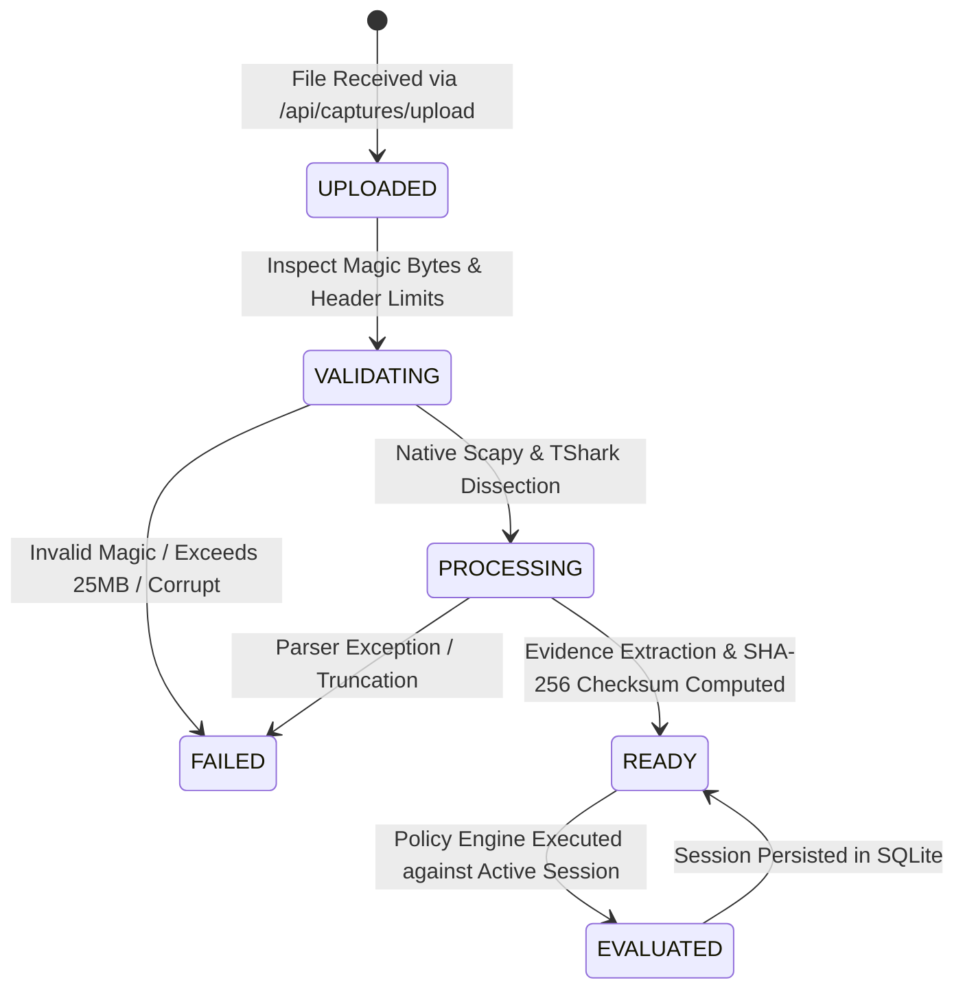
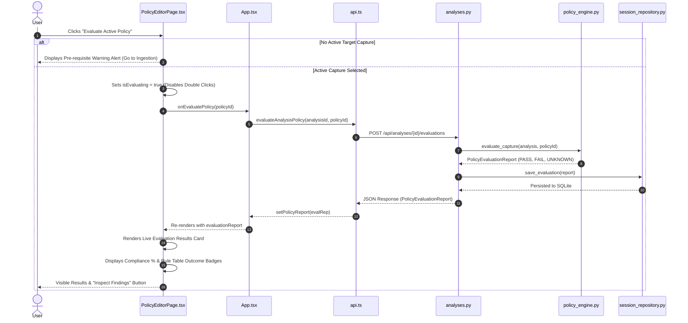

# IKETrace — Session-Aware Dynamic Analysis Architecture

## 1. Executive Summary & Problem Definition

In prior iterations, IKETrace operated primarily against pre-loaded laboratory fixture files. While the parsing and deterministic rule engines were mathematically sound, user-uploaded captures were held in volatile in-memory dictionaries without a structured persistence layer. Furthermore, the frontend client defaulted to auto-selecting fixture captures on startup, certain views hardcoded policy identifiers, and the "Evaluate Active Policy" button lacked visual completion signaling.

This specification documents the **Session-Aware Dynamic Analysis Architecture** implemented to transform IKETrace into a strict, offline-first defensive assurance workbench where every control, chart, metric, finding, cryptographic inventory, and assessment report is derived exclusively from the currently active, verified analysis session.

---

## 2. Core Domain Model & Session Lifecycle

Each uploaded capture initiates an isolated analysis session identified by a unique, cryptographically random `analysis_id` (e.g., `cap-f8a19bc34e21`).

### 2.1 State Transition Model



1. **`UPLOADED`**: Capture file bytes received via multipart form; temporary server-sanitized path generated.
2. **`VALIDATING`**: Inspects PCAP / PCAPNG magic numbers (`0xa1b2c3d4`, `0xd4c3b2a1`, `0xa1b2cd34`, `0x34cdb2a1`, `0x0a0d0d0a`) and enforces the 25MB safety boundary.
3. **`PROCESSING`**: Stream-dissects IKEv1/v2 exchanges, proposal substructures, transform attributes, and ESP sequences.
4. **`READY`**: Computes SHA-256 fingerprint, compiles structured packet summaries, groups VPN sessions, extracts evidence items, and persists session to SQLite.
5. **`FAILED`**: Captures parser errors, truncated packets, or malformed inputs without crashing the daemon.

---

## 3. SQLite Persistence Layer (`iketrace.db`)

To ensure offline operation without binary dependency failures, IKETrace utilizes Python's built-in standard library `sqlite3` database engine. All foreign keys enforce cascade deletion so that removing an analysis session automatically purges dependent evaluations, inventories, and reports.

```sql
CREATE TABLE IF NOT EXISTS analyses (
    analysis_id TEXT PRIMARY KEY,
    filename TEXT NOT NULL,
    file_hash_sha256 TEXT NOT NULL,
    file_size_bytes INTEGER NOT NULL,
    status TEXT NOT NULL,
    error_message TEXT,
    uploaded_at TEXT NOT NULL,
    total_packets INTEGER DEFAULT 0,
    ike_packets INTEGER DEFAULT 0,
    esp_packets INTEGER DEFAULT 0,
    other_packets INTEGER DEFAULT 0,
    session_count INTEGER DEFAULT 0,
    parse_completeness_pct REAL DEFAULT 0.0,
    parser_backend TEXT DEFAULT 'scapy_native',
    parser_warnings_json TEXT DEFAULT '[]',
    sessions_json TEXT DEFAULT '[]',
    packets_json TEXT DEFAULT '[]',
    evidence_items_json TEXT DEFAULT '[]',
    created_at TEXT NOT NULL,
    updated_at TEXT NOT NULL
);

CREATE TABLE IF NOT EXISTS evaluations (
    evaluation_id TEXT PRIMARY KEY,
    analysis_id TEXT NOT NULL,
    policy_id TEXT NOT NULL,
    policy_name TEXT NOT NULL,
    policy_version TEXT NOT NULL,
    evaluated_at TEXT NOT NULL,
    compliance_score_pct REAL NOT NULL,
    total_rules INTEGER NOT NULL,
    passed_count INTEGER NOT NULL,
    failed_count INTEGER NOT NULL,
    unknown_count INTEGER NOT NULL,
    not_applicable_count INTEGER NOT NULL,
    report_json TEXT NOT NULL,
    FOREIGN KEY (analysis_id) REFERENCES analyses (analysis_id) ON DELETE CASCADE
);

CREATE TABLE IF NOT EXISTS crypto_inventories (
    inventory_id TEXT PRIMARY KEY,
    analysis_id TEXT NOT NULL,
    generated_at TEXT NOT NULL,
    pqc_readiness_score_pct REAL NOT NULL,
    report_json TEXT NOT NULL,
    FOREIGN KEY (analysis_id) REFERENCES analyses (analysis_id) ON DELETE CASCADE
);

CREATE TABLE IF NOT EXISTS assessment_reports (
    report_id TEXT PRIMARY KEY,
    analysis_id TEXT NOT NULL,
    title TEXT NOT NULL,
    policy_id TEXT NOT NULL,
    generated_at TEXT NOT NULL,
    markdown_content TEXT NOT NULL,
    report_hash TEXT NOT NULL,
    FOREIGN KEY (analysis_id) REFERENCES analyses (analysis_id) ON DELETE CASCADE
);
```

---

## 4. REST API Contracts (`/api/analyses/...`)

The API introduces dedicated session-scoped endpoints while preserving backwards compatibility:

| Method | Endpoint | Description | Session-Scoped |
| :--- | :--- | :--- | :---: |
| `GET` | `/api/analyses` | List all persisted analysis sessions with SHA-256 and metadata | Yes |
| `GET` | `/api/analyses/{id}` | Retrieve metadata and packet breakdown for session `{id}` | Yes |
| `DELETE` | `/api/analyses/{id}` | Cascade-delete session `{id}` and its associated evaluations | Yes |
| `GET` | `/api/analyses/{id}/protocols` | Parsed packet timeline and IKE/ESP proposal payloads | Yes |
| `GET` | `/api/analyses/{id}/sessions` | Extracted VPN sessions with SPIs and endpoints | Yes |
| `POST` | `/api/analyses/{id}/evaluations` | Execute deterministic policy evaluation and persist result | Yes |
| `GET` | `/api/analyses/{id}/evaluations` | List saved evaluations for session `{id}` | Yes |
| `GET` | `/api/analyses/{id}/findings` | Retrieve rule-level security findings for session `{id}` | Yes |
| `GET` | `/api/analyses/{id}/crypto-inventory` | Extract cryptographic asset register and PQC score | Yes |
| `GET` | `/api/analyses/{id}/reports` | List official assessment reports compiled for `{id}` | Yes |
| `GET` | `/api/analyses/{id}/traffic-flows` | Extract real packet flow features & run ML inference | Yes |

---

## 5. Execution Path: "Evaluate Active Policy"

The unresponsive Evaluate button was resolved by correcting the full end-to-end execution path:



---

## 6. Frontend Session Isolation & Honest Empty States

1. **Initial Startup State**:
   - `selectedCaptureId` defaults to `null`.
   - `policyReport` and `cryptoInventory` default to `null`.
   - The UI renders honest empty states across all pages rather than auto-selecting demo fixtures.
2. **Session Switching**:
   - Switching from Capture A to Capture B immediately clears prior state (`setPolicyReport(null)` and `setCryptoInventory(null)`).
   - In parallel, session-scoped endpoints (`/api/analyses/{B}/evaluations`, `/api/analyses/{B}/crypto-inventory`, `/api/analyses/{B}/reports`) load B's distinct persisted records.
3. **Multi-Session Independence**:
   - Findings from Capture A never appear on Capture B.
   - Generated reports for Capture A are filtered to `target_id === A`.
   - Returning to Capture A from session history restores A's evaluation results from SQLite without re-evaluating or cross-contaminating.

---

## 7. Real Traffic Metadata vs. Synthetic Benchmarks

In the **Traffic Privacy Lab** (`/api/analyses/{id}/traffic-flows`):
- **Real Packet Features**: Deterministically extracts statistical flow metadata (`packet_count`, `total_bytes`, `duration_seconds`, `mean_packet_size`, `std_packet_size`, `mean_iat_ms`, `burst_count`, `forward_backward_ratio`) from active capture packets.
- **Inference Only**: The trained Random Forest classifier performs inference on active flows without claiming payload decryption or key recovery.
- **Training Separation**: Model benchmarking and cross-validation strictly disclose that training was conducted on controlled synthetic flows under Group-KFold isolation to avoid flow leakage. If a user capture has fewer than 30 flows, fine-tuning is disabled with an explicit limitation notice.

---

## 8. Verification & Test Evidence

The session-aware data flow is verified by 20 automated backend integration tests and zero-defect frontend production compilation:

- `test_session_aware_analysis_lifecycle_and_isolation`: Validates multi-capture ingestion, SQLite persistence, rule outcome divergence between compliant (IKEv2) and prohibited (3DES/MD5) captures, and report isolation.
- `test_incomplete_handshake_yields_unknown_on_negotiated_rules`: Ensures offered transforms in incomplete handshakes return `UNKNOWN`, never false `PASS`.
- `test_tamper_evident_audit_chain_and_detection`: Confirms SHA-256 hash chaining and truncation detection.
